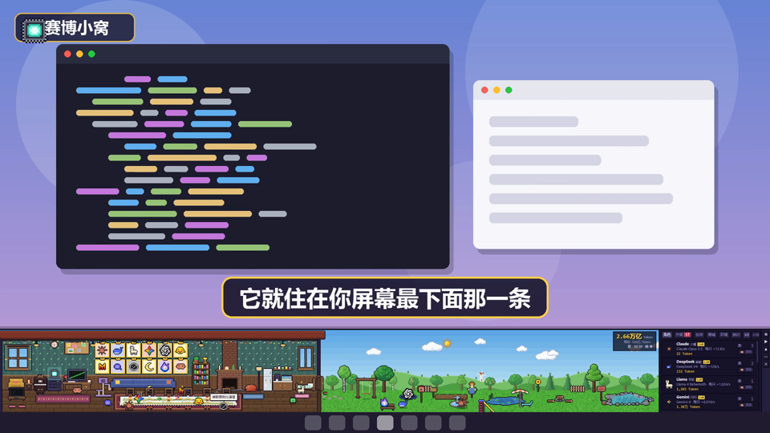
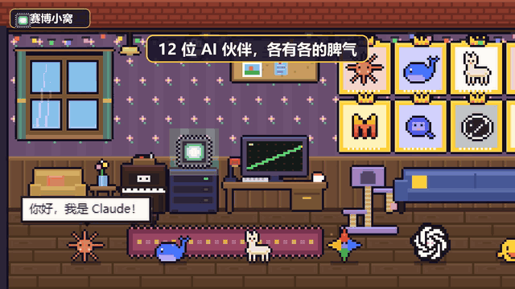
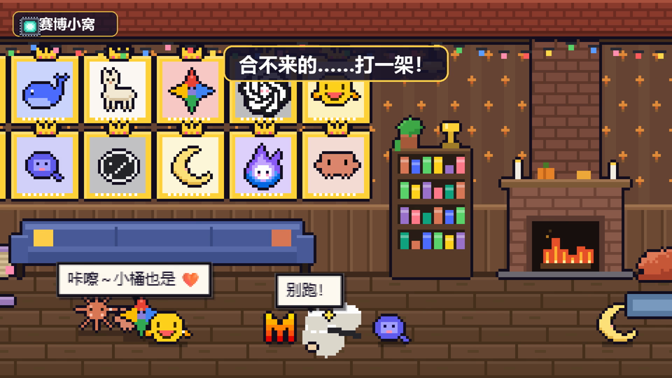
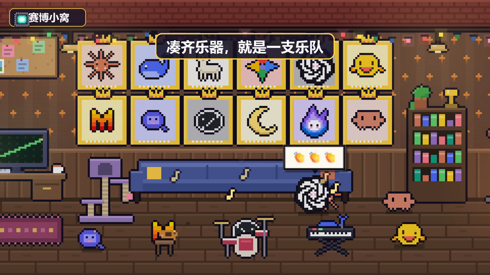
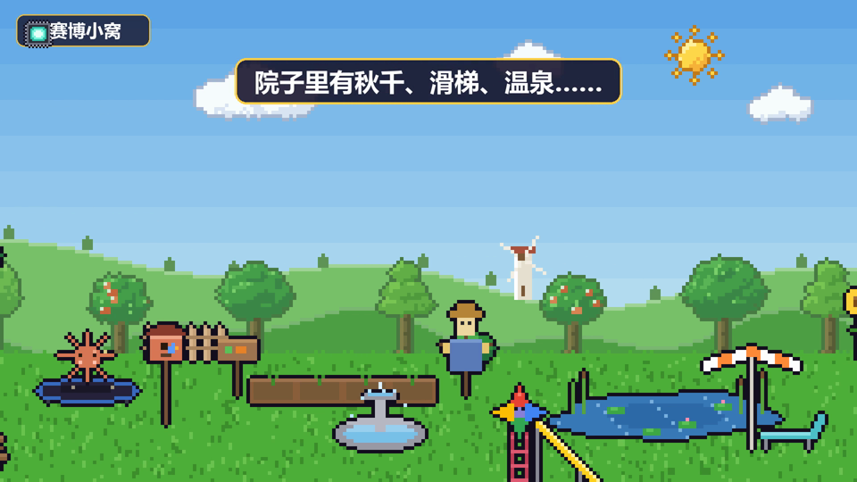
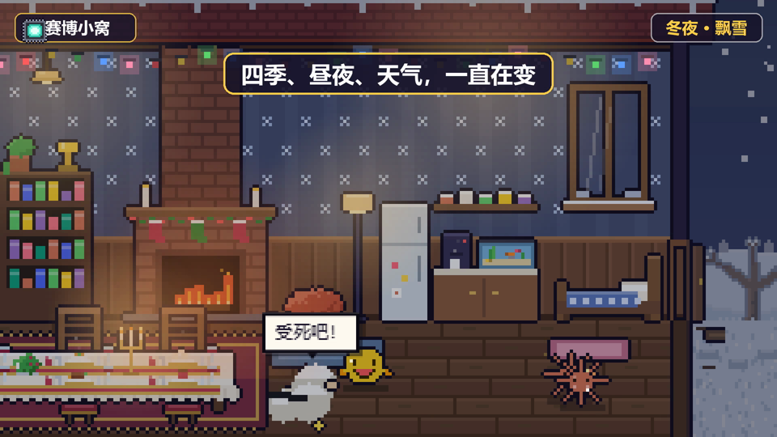

# 赛博小窝

> 一群 AI，住在你的桌面上。

**赛博小窝**是一个像素风的桌面放置小游戏：它是一条贴在屏幕最下面的长条窗口，里面住着 12 位以各家 AI 为原型的小伙伴。它们会自己溜达、聊天、斗嘴、抱抱、打架、组乐队，挂着就能慢慢赚 Token，用来请新伙伴、升级模型、添置家具、装修小窝。





🎬 [看一段 73 秒的宣传片](docs/promo.mp4)

## 小窝里有什么

- **12 位 AI 伙伴**：小橘（Claude）、鲸鲸（DeepSeek）、羊驼（Llama）、闪闪（Gemini）、结结（ChatGPT）、抱抱脸（Hugging Face）、小风（Mistral）、千问（Qwen）、斜杠（Grok）、月月（Kimi）、缪缪（Muse），以及压轴登场的小钳（Clawd）。每一位都有自己的性格和一大堆台词。
- **关系网**：一起聊天、吃饭、泡温泉会越来越熟。关系好的会抱抱、击掌，合不来的会吵架，甚至打成一团卡通烟尘。还可以在关系网里花一点 Token 撮合或挑拨它们。
- **好感度和统计**：每一只都有自己的名字、好感度、配饰，还记着被戳了几次、摔了几跤、抓了几只 Bug。
- **能拖能甩**：拎起来会挣扎抗议，丢到椅子、床、温泉上会自己坐下，甩出去会 Q 弹地弹几下。
- **合奏**：买齐吉他、小提琴、电子琴、架子鼓，两只以上一起演奏就是一支乐队，会真的放出音乐。唱片机里还有 4 首原创小曲。
- **装修**：家具、窗户、挂件、院子里的设施都能拖到想放的地方，也能收进仓库。新开局只有几件家具，其他的都要用 Token 一件件买回来。
- **四季、昼夜、天气**：可以跟随现实时间，也可以加速。会下雨、打雷、下雪、起雾、出彩虹。
- **院子**：秋千、蹦床、菜园、钓鱼池塘、篝火、温泉、滑梯、沙坑、喷泉……
- **神之手**：不想慢慢攒的话，统计页里有一个作弊开关。

| | |
|---|---|
|  |  |
|  |  |

## 怎么运行

需要先装好 [Node.js](https://nodejs.org/)（18 或更新的版本）。

```bash
git clone https://github.com/tweetyluckless/cyber-nest.git
cd cyber-nest
npm install
npm start
```

Windows 上装好依赖之后，以后直接双击 `start.bat` 就能打开。

窗口会贴在屏幕最下面，宽度和屏幕一样，高度大约是屏幕的五分之一。右边那一列小按钮可以收起菜单、置顶、最小化和关闭；🛠 是装修模式。

## 怎么玩

- 点屋里发光的**芯片**赚 Token，地上偶尔会爬出一只 **Bug**，点它有奖励。
- 在"角色"页请新伙伴、升级模型；"升级"页买产出加成。
- 在"商城"里买礼物、配饰、家具、乐器和增益道具，礼物和配饰在"伙伴"页送出去。
- "伙伴"页可以看每一只的状态，切到"关系网"看谁和谁要好。
- "环境"页可以切换季节、昼夜和天气，调音量，也能管理装修和仓库。
- 存档自动保存在本地，关掉游戏也会按一半的速度累积离线收益（最多 8 小时）。

## 技术

- [Electron](https://www.electronjs.org/) 无边框窗口 + 原生 JavaScript，没有用任何游戏引擎。
- 所有画面都是在 Canvas 上一个像素一个像素画出来的，角色是手写的像素字符画。
- 音乐和音效都是用 Web Audio 现场合成的，没有音频文件。

| 文件 | 内容 |
| --- | --- |
| `main.js` / `preload.js` | Electron 窗口 |
| `sprites.js` | 角色和图标的像素画 |
| `dialogue.js` | 所有台词和对话 |
| `items.js` | 商城商品 |
| `game.js` | 存档、数值、关系 |
| `scene.js` | 场景绘制、角色行为、装修 |
| `music.js` | 合成音乐 |
| `ui.js` / `index.html` / `style.css` | 菜单和界面 |

## 声明

这是一个粉丝自制的非商业小游戏。角色形象致敬了各家 AI 产品，相关名称和商标归各自的公司所有，本项目与这些公司没有任何关联。

## 协议

[MIT](LICENSE)
